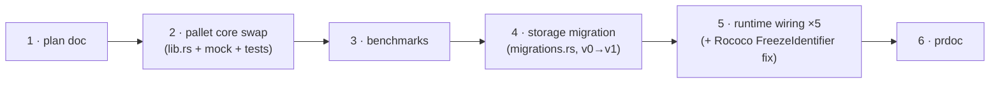
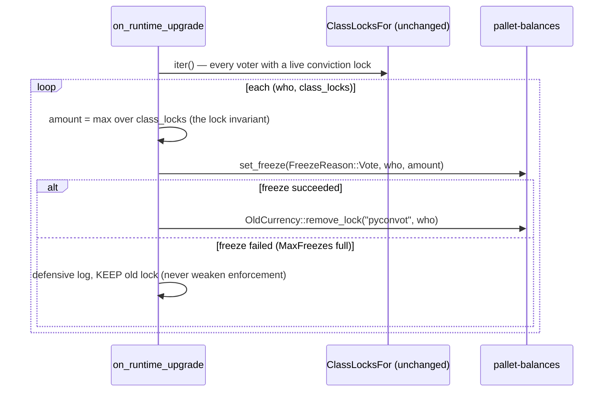

# Migrating `pallet-conviction-voting` from `Currency` locks to `fungible` freezes

Implementation plan for completing the conviction-voting checkbox of
[paritytech/polkadot-sdk#226](https://github.com/paritytech/polkadot-sdk/issues/226)
(the `Currency`-trait deprecation). A previous attempt,
[PR #1821](https://github.com/paritytech/polkadot-sdk/pull/1821), was closed unmerged in 2024;
this plan is a fresh start against today's code.

Background reading: `CONVICTION-VOTING-TOKEN-SOURCES-AND-LOCKS.md` (same repo root) — in
particular the section *"Lock vs freeze — two generations of API for the same mechanism"*.

## TL;DR

Swap the pallet's `LockableCurrency` **lock** (`"pyconvot"`) for a `fungible::MutateFreeze`
**freeze** (`FreezeReason::Vote`). Behavior is preserved exactly — both primitives feed the same
`AccountData.frozen` field via `max()` — so the existing behavior-level tests (all asserted via
`usable_balance`) become the regression suite. The work splits into five mechanical steps, one
commit each, plus a storage migration that moves every voter's on-chain `Locks` entry into a
`Freezes` entry.

**Read this branch commit-by-commit** — each commit is one plan step and leaves the tree green:

| # | Commit | Step | Green under |
|---|---|---|---|
| 1 | plan doc (this file) | — | — |
| 2 | swap locks → freezes in pallet + mock + tests | Steps 1–2 | `cargo test -p pallet-conviction-voting` |
| 3 | benchmarks to fungible traits | Step 3 | same + `--features runtime-benchmarks` |
| 4 | v1 lock→freeze storage migration | Step 4 | same, incl. migration unit tests |
| 5 | wire the 5 in-repo runtimes | Step 5 | `SKIP_WASM_BUILD=1 cargo check` per runtime |
| 6 | prdoc | Step 6 | prdoc schema check |



## Baseline audit — every touchpoint of the old API

The pallet's entire currency surface is four call sites and one bound (verified by grep; the
exact command: `grep -n "Currency\|Lock" substrate/frame/conviction-voting/src/lib.rs`):

| Site | Old API | New API | Notes |
|---|---|---|---|
| `Config::Currency` bound (`lib.rs:117-119`) | `ReservableCurrency + LockableCurrency + fungible::Inspect` | `fungible::Inspect + fungible::Mutate + fungible::MutateFreeze<Id = RuntimeFreezeReason>` | `ReservableCurrency` is **never used** — vestigial from the pallet-democracy copy. Drop it. |
| `try_vote` / `try_delegate` gate (`lib.rs:433`, `lib.rs:634`) | `T::Currency::total_balance` | unchanged — `fungible::Inspect::total_balance` | Same name, new trait resolves it once `Currency` bound is gone. |
| `extend_lock` (`lib.rs:723`) | `extend_lock(ID, who, amount, reasons)` — infallible | `extend_freeze(&reason, who, amount)` — **fallible** | Same "only ratchet up" semantics. |
| `update_lock` (`lib.rs:752-759`) | `set_lock` / `remove_lock` — infallible | `set_freeze` / `thaw` — **fallible** | Same "recompute to max over classes" semantics. |
| `BalanceOf` (`lib.rs:73-74`) | `Currency::Balance` | `fungible::Inspect::Balance` | Type identical in practice (`Balances` implements both with the same `Balance`). |

Benchmarks additionally use `make_free_balance_be` and `free_balance`
(`benchmarking.rs:58,259-260`) → `fungible::Mutate::set_balance` and `fungible::Inspect::balance`.

## Decisions (ADR)

### D1 — Keep the associated type named `Currency`

- **Options:** rename to `Fungible` (advertises the migration) vs keep `Currency` (zero churn
  for downstream `type Currency = Balances;` lines).
- **Decision:** keep `Currency`. Precedent: `pallet-nomination-pools` migrated to
  `fungible::MutateFreeze` and kept the name (`nomination-pools/src/lib.rs:1669`). Every
  downstream runtime keeps compiling with its existing `type Currency = Balances;` line; the only
  new wiring is the added `RuntimeFreezeReason` type.
- **Consequence accepted:** the name under-communicates the trait family; the bound itself is
  the documentation.

### D2 — Typed freeze reason via `composite_enum`, single variant `Vote`

The untyped `*b"pyconvot"` `LockIdentifier` becomes:

```rust
#[pallet::composite_enum]
pub enum FreezeReason<I: 'static = ()> {
    /// Funds are frozen because they back (or backed) a conviction vote / delegation.
    #[codec(index = 0)]
    Vote,
}
```

plus `type RuntimeFreezeReason: From<FreezeReason<I>>` in `Config`, exactly the
nomination-pools pattern. The pallet is instanced, so the composite enum carries the instance
parameter — each instance of the pallet gets its own variant in the runtime-aggregated
`RuntimeFreezeReason`. (This is *better* than today: all instances currently share the single
`"pyconvot"` lock id, silently maxing across instances — a latent bug the migration fixes.)

### D3 — One freeze for the whole pallet, not one per class

- **Options:** (a) single freeze = max over classes (mirrors today's single lock);
  (b) one freeze per voting class.
- **Decision:** (a). `ClassLocksFor` already stores the per-class breakdown; the on-chain
  encumbrance has always been the max. Per-class freezes would multiply `Freezes` entries per
  voter (bounded by `MaxFreezes`!) for zero behavioral gain, and would be a *semantic* change
  (freezes across reasons also combine by max, so even (b) nets out the same — just with more
  storage).
- **Consequence accepted:** none — this is behavior-preserving by construction.

### D4 — Propagate freeze errors instead of swallowing them

`extend_lock`/`set_lock` were infallible; `extend_freeze`/`set_freeze`/`thaw` return
`DispatchResult` (they can fail if the `Freezes` vec is full, i.e. `MaxFreezes` misconfigured).
The old code *had* to be infallible; the new code should not pretend to be:

- `Self::extend_freeze_for(...)` returns `DispatchResult`, propagated out of
  `try_vote`/`try_delegate` (both already return `DispatchResult`, and both call sites sit
  inside `try_mutate` transactions, so failure rolls back cleanly).
- `update_lock` → `update_freeze`, returns `DispatchResult`, propagated out of `unlock`.

📚 **Principle:** *when a migration hands you fallibility, thread it — a silently ignored `Err`
in a lock-accounting path is a security bug waiting for a misconfiguration.*

### D5 — Classic single-block `VersionedMigration`, MBM explicitly deferred

- **Context:** every account in `ClassLocksFor` needs its `Locks` entry rewritten into a
  `Freezes` entry. On the in-repo runtimes (Rococo, Asset Hub Westend, kitchensink, two
  staking-async test runtimes) voter counts are small. On a production Polkadot/Kusama Asset Hub
  there are hundreds of thousands of voters — a single-block migration would brick the chain.
- **Options:** (a) classic `OnRuntimeUpgrade` wrapped in `VersionedMigration<0, 1, …>`;
  (b) multi-block `SteppedMigration`.
- **Decision:** (a) for this repo, with the MBM variant named as **required follow-up before
  the fellows runtimes adopt the bump**. Precedent: `pallet-staking`'s currency migrations
  shipped classic first (`staking/src/migrations.rs`).
- **Consequence accepted:** the fellows-runtimes release note must carry a red flag; the
  migration struct is written so its per-account body can be lifted into a `SteppedMigration`
  verbatim.

### D6 — Migration is generic over `OldCurrency`

After the swap the pallet no longer knows `LockableCurrency` exists. The migration takes it
back as an explicit type parameter (staking precedent):

```rust
pub type MigrateV0ToV1<T, OldCurrency, I = ()> = VersionedMigration<0, 1,
    v1::VoteLockToFreeze<T, OldCurrency, I>, Pallet<T, I>, DbWeight>;
// runtime wires: MigrateV0ToV1<Runtime, Balances>
```

## Step-by-step implementation plan

### Step 1 — pallet core swap (`lib.rs`)

1. `Config`: replace the three-trait `Currency` bound with
   `fungible::Inspect + fungible::Mutate + fungible::MutateFreeze<Id = Self::RuntimeFreezeReason>`;
   add `type RuntimeFreezeReason: From<FreezeReason<I>>`.
   (`fungible::Mutate` is included unconditionally for benchmark/test funding — nomination-pools
   precedent; a `runtime-benchmarks`-only bound on an associated type is not expressible.)
2. Add the `FreezeReason` composite enum (D2) and `STORAGE_VERSION = 1` +
   `#[pallet::storage_version]` (pallet currently has none, i.e. v0).
3. `BalanceOf` via `fungible::Inspect`.
4. `extend_lock` → `extend_freeze_for` (name avoids clashing with the trait method), fallible,
   calls `T::Currency::extend_freeze(&FreezeReason::Vote.into(), who, amount)`; keep the
   `ClassLocksFor` bookkeeping identical. **Order matters**: take the freeze *before* mutating
   `ClassLocksFor`? No — keep bookkeeping-first exactly as today, because both happen inside the
   caller's `try_mutate` transaction; on `Err` everything unwinds. Document this with a comment.
5. `update_lock` → `update_freeze`, fallible: `thaw` when the needed amount is zero, else
   `set_freeze`. Propagate from `unlock`.
6. Delete `LockIdentifier`/`WithdrawReasons`/`LockableCurrency`/`ReservableCurrency`/`Currency`
   imports. `CONVICTION_VOTING_ID` moves into the migration module (Step 4) — it is now *only*
   migration vocabulary.

### Step 2 — mock + tests (`tests.rs`)

1. Mock: `type RuntimeFreezeReason = RuntimeFreezeReason;` in both the balances config (the
   `TestDefaultConfig` prelude already derives `FreezeIdentifier = RuntimeFreezeReason` and
   `MaxFreezes = VariantCountOf<…>` from it) and the pallet config.
2. Existing tests assert through `usable_balance` — behavior-level, so they must pass
   **unchanged**. Any test edit beyond the mock config is a smell that behavior drifted.
3. Add two targeted new tests: (a) the freeze is registered under
   `FreezeReason::Vote` (`balance_frozen` inspection — the typed-reason upgrade is observable);
   (b) `unlock` thaws completely (no residual `Freezes` entry) when all votes are removed.

### Step 3 — benchmarks (`benchmarking.rs`)

`make_free_balance_be(max)` → `fungible::Mutate::set_balance`; `free_balance` →
`fungible::Inspect::balance`; drop the `Currency` import. No structural changes. Weights are
**not** regenerated here — storage access shape changes (`Balances::Locks` → `Balances::Freezes`,
same count), so `/cmd bench` runs on the upstream PR; until then old weights are a safe
same-shape approximation.

### Step 4 — storage migration (`migrations.rs`, new file)



- `v1::VoteLockToFreeze<T, OldCurrency, I>` implementing `UncheckedOnRuntimeUpgrade`, wrapped by
  `MigrateV0ToV1` (D6). Freeze-first ordering: **the account must never pass through a state
  with neither lock nor freeze** — that would be a window (within one block, but still) where a
  conviction-locked balance is transferable.
- Weight: count iterated accounts, return `T::DbWeight` reads/writes accordingly.
- `try-runtime` hooks: `pre_upgrade` encodes `(account, expected_amount)` pairs from
  `ClassLocksFor`; `post_upgrade` asserts `balance_frozen(Vote, who) == expected` and
  `OldCurrency::balance_locked("pyconvot", who) == 0` (via `InspectLockableCurrency`).
- Unit tests in the mock: seed genesis, place a legacy lock + `ClassLocksFor` by hand, run the
  migration, assert freeze amount, lock gone, `usable_balance` unchanged before/after.

### Step 5 — runtime wiring (5 runtimes)

For each of: kitchensink (`substrate/bin/node/runtime`), Rococo, Asset Hub Westend,
staking-async rc + parachain test runtimes:

1. `impl pallet_conviction_voting::Config`: add
   `type RuntimeFreezeReason = RuntimeFreezeReason;`.
2. Append `pallet_conviction_voting::migrations::MigrateV0ToV1<Runtime, Balances>` to the
   runtime's `Migrations` tuple.
3. **Rococo only:** main `Balances` has `FreezeIdentifier = ()`, `MaxFreezes = ConstU32<1>`
   (`rococo/src/lib.rs:426-429`) → `FreezeIdentifier = RuntimeFreezeReason`,
   `MaxFreezes = VariantCountOf<RuntimeFreezeReason>`. Safe because **nothing on Rococo uses
   freezes today** (verified: no `set_freeze` caller wires Rococo's `Balances`; `pallet-nis`
   uses holds/reserves, and the `NisCounterpartBalances` instance is untouched), so the
   `Freezes` storage is empty and its value-type change is vacuous.

### Step 6 — prdoc

`major` bump for `pallet-conviction-voting` (Config change + storage migration), `patch`/`minor`
for the touched runtime crates, explicit callout: *downstream runtimes must add
`RuntimeFreezeReason`, schedule `MigrateV0ToV1`, and ensure `MaxFreezes` accounts for the new
variant; chains with large voter counts must convert to a stepped migration first (D5).*

## Invariants (must hold before = after)

1. For every account: `usable_balance` is identical before and after the swap and across the
   storage migration (locks and freezes both floor via `frozen = max(…)`).
2. The encumbrance never disappears: at no point (including mid-migration) is a
   conviction-locked balance transferable. Freeze-first ordering in Step 4 enforces this.
3. `ClassLocksFor` semantics unchanged: on-chain freeze amount = max over classes = max over
   live votes and prior locks per class.
4. Holds still compose: staked (held) balance keeps voting, and the freeze keeps discounting
   held funds (`untouchable = frozen − reserved`) — the four tests from
   `CONVICTION-VOTING-TOKEN-SOURCES-AND-LOCKS.md` must pass unchanged.

## Footguns / failure modes

- **`MaxFreezes` too small in a downstream runtime** → every `vote` fails with `TooManyFreezes`
  at dispatch time (thanks to D4 it fails *loudly*, not silently). Detection: any vote fails on
  an upgraded chain. Fix: `MaxFreezes = VariantCountOf<RuntimeFreezeReason>`.
- **Forgetting the migration while shipping the code swap** → old `"pyconvot"` locks linger
  (still enforced by balances — locks don't need the pallet alive) *and* new freezes accumulate:
  double-encumbrance, users over-frozen until `unlock`. Detection: `Locks` entries with
  `pyconvot` id on a chain running v1 code. This is why the storage-version gate exists.
- **Single-block migration on a big chain** (D5) — bricked block. The fellows runtimes must not
  adopt this without the stepped variant.
- **Instances**: each instance now freezes under its own reason. A chain running two instances
  today shares one `"pyconvot"` lock (max across instances); after migration the two freezes
  *also* combine by max inside balances — behavior identical, but the migration for instance 2
  must not remove a lock still needed by instance 1. In-repo, no runtime uses a second instance,
  and the migration guards this by being per-instance versioned. Called out for downstream.
- **Weights are stale by one storage-map shape** until `/cmd bench` on the upstream PR (Step 3).

## Verification

```bash
# after commit 2 (and every later commit):
SKIP_WASM_BUILD=1 cargo test -p pallet-conviction-voting
# after commit 3:
SKIP_WASM_BUILD=1 cargo test -p pallet-conviction-voting --features runtime-benchmarks
# after commit 5, per runtime:
SKIP_WASM_BUILD=1 cargo check -p rococo-runtime -p asset-hub-westend-runtime \
  -p kitchensink-runtime -p pallet-staking-async-rc-runtime \
  -p pallet-staking-async-parachain-runtime
# migration specifically:
SKIP_WASM_BUILD=1 cargo test -p pallet-conviction-voting migration
```

## Glossary delta

- **`FreezeReason::Vote`** — this pallet's typed successor to the `"pyconvot"` lock id.
- **`RuntimeFreezeReason`** — the runtime-aggregated enum of every pallet's `FreezeReason`
  composite; balances stores freezes keyed by it.
- **`VersionedMigration<0, 1, …>`** — frame-support wrapper that runs the inner migration only
  when the pallet's on-chain storage version is exactly 0, then bumps it to 1.
